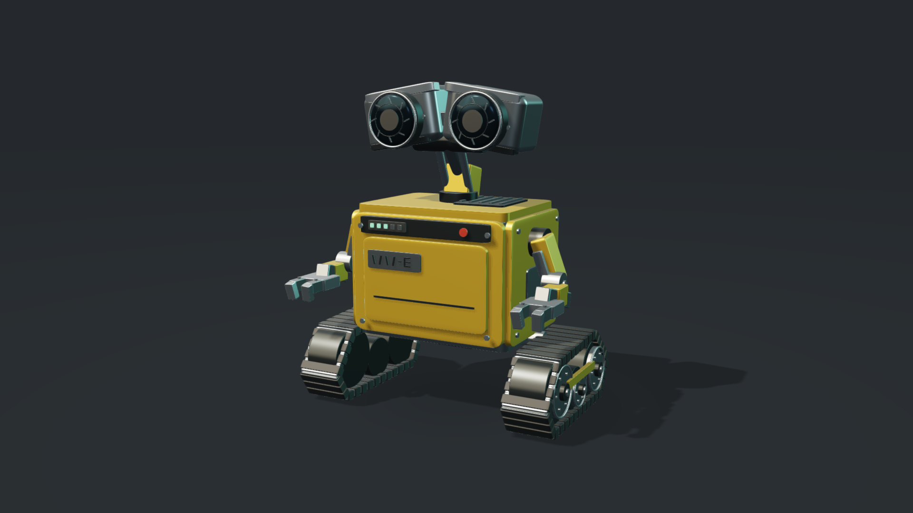

# 67.js

67.js is an experimental WebGL2 renderer with an explodable WALL·E study, an interactive nature world and a deterministic 3D short film.
The viewers run without Three.js. The optional benchmark loads Three.js separately.



The WALL·E study contains 574 parts, 860,380 triangles and seven shared geometries.
The studio submits eight geometry draws, including the floor.
Its slider separates all 574 components, including individual fasteners, tread shoes, gears and electronics, to expose batteries, circuit boards, motors, gears and optical mechanisms.
The layer controls show the shell, the interior or both. GLB export preserves the selected layers, finish and explosion amount.

The renderer uses sampled fillets, GGX lighting, shadows, explicit MSAA, FXAA, specular filtering and ACES tone mapping.
It reuses geometry buffers during explosion and refreshes shadows without allocating another shadow texture.
The studio renders on demand. Continuous animation pauses in hidden tabs.

## Install

```sh
npm install 67js@npm:@codepawlhq/67js
```

The registry package is `@codepawlhq/67js`. Its local alias is `67js`, so imports stay short. The project brand is 67.js. The library is ESM and bundles its runtime dependencies. Core exports include `Renderer67`, `box`, `cylinder`, `sphere`, `torus`, `assemblyOffset`, `exportGlb`, render budget helpers and `VERSION`. Scene constructors are separate addons. Browser module downloads and the guide are available at https://67js.codepawl.com.

## Run

1. Install Node.js 22.12 or newer.
2. Run `npm ci`.
3. Run `npm run dev`.
4. Open the URL printed by Vite.

| Page | Experience |
| --- | --- |
| `/` | Installation, downloads, release metadata and examples. |
| `/object.html` | WALL·E studio with orbit, zoom, explosion, layers, finishes and GLB export. |
| `/nature.html` | Silverwater valley with viewpoints, daylight, wind, detail settings and water ripples. |
| `/film.html` | CRITICAL, a 32-second procedural film with playback and timeline controls. |

CRITICAL combines mechanical details, atomic orbits, waves, a desert test tower and a volumetric ignition sequence.
It uses an original synthesized score. The playable MP4 is in `public/media/critical.mp4`.
The nature world uses seeded terrain and instanced vegetation. Its balanced preset contains 2,673 parts and 585,470 triangles.

## Render images and video

1. Run `npm run score` to generate the original soundtrack.
2. Choose a command below for the required scene and backend.
3. Inspect the output and its JSON report.

```powershell
npm run render -- --kind image --scene object --backend gpu --preset high --output artifacts/wall-e.png
npm run render -- --kind image --scene nature --backend gpu --preset high --output artifacts/nature.png
npm run render -- --kind image --scene object --backend cpu --preset cpu --output artifacts/wall-e-cpu.png
npm run render -- --kind video --scene film --backend gpu --preset balanced --encoder gpu --output public/media/critical.mp4
```

| Preset | Dimensions | MSAA samples | FPS | Target budget |
| --- | --- | ---: | ---: | ---: |
| `preview` | 960 × 540 | 2 | 24 | 256 MiB |
| `balanced` | 1280 × 720 | 4 | 24 | 384 MiB |
| `high` | 1920 × 1080 | 4 | 24 | 512 MiB |
| `cpu` | 640 × 360 | 1 | 12 | 192 MiB |

GPU rendering uses hardware WebGL. CPU rendering explicitly requests and verifies ANGLE SwiftShader.
The encoder independently supports two-thread libx264 or NVIDIA NVENC.
The exporter streams one frame at a time and waits for encoder backpressure.
It keeps one live scene renderer and disables development reloads during capture.

The planner reduces render dimensions before targets exceed their estimated budget.
The estimate includes geometry, shadows, targets and frame staging. It excludes some browser and driver allocations.
The report records actual dimensions, estimated render memory, Node RSS and sampled browser JavaScript heap.
Node and JavaScript heap guards stop capture above 512 MiB and 256 MiB respectively.
These guards cannot guarantee that every driver or system allocation succeeds.

## Skills

The repository includes two reusable Codex skills.

- [build-67js-scene](skills/build-67js-scene/SKILL.md) covers geometry, materials, cameras, interaction and anti-aliasing.
- [render-67js-media](skills/render-67js-media/SKILL.md) covers CPU/GPU presets, streaming exports and memory measurements.

## Checks and performance

1. Run `npm test` to validate geometry, scene budgets, the timeline and independent GLB loading.
2. Run `npm run build` to create the homepage, guide and three production viewers in `dist/`.
3. Run `npm run smoke` to exercise the studio in headless Chrome.

The smoke saves rendered screenshots, a GLB and benchmark results under the ignored `artifacts/` directory.
The benchmark compares identical geometry, camera, resolution and flat shaders with both instanced and individual draws.
It measures CPU submission over 120 samples after warmup, with GPU synchronization outside the timed region.

The results establish no general speed advantage or visual parity with Three.js or Blender.
Vite serves COOP and COEP headers for fine browser timers. Other hosts need equivalent headers for comparable timing.
Detailed measured results and limits are in [verification.md](docs/verification.md).

## API

`createModel()` returns shared geometries, column-major matrices, linear RGB materials and optional assembly offsets.
`Renderer67` groups geometry identities into instanced batches.

```js
import { Renderer67 } from '67js';
import { createModel } from '67js/addons/model';

const renderer = new Renderer67(canvas, createModel(), {
  samples: 4,
  memoryBudgetMiB: 256,
});
renderer.render({ eye: [4, 3, 7], target: [0, 1.5, 0], assemblyAmount: 0.5 });
// Call resize() after CSS dimensions change.
// Call dispose() before replacing the renderer.
```

This prototype supports procedural scenes and authored animation. It lacks texture loading, ray tracing and a general scene graph.
Blender-level realism remains a visual target.

## Credits

WALL·E is a Disney/Pixar character. This repository authors its study as procedural geometry without external model assets.
CRITICAL draws inspiration from the visual themes of the [official Oppenheimer trailer](https://www.youtube.com/watch?v=bK6ldnjE3Y0).
It includes no film footage, dialogue or soundtrack samples.

- [Three.js](https://threejs.org/) and its [source](https://github.com/mrdoob/three.js/) provide the benchmark reference.
- [Blender](https://projects.blender.org/blender/blender) provides the visual quality target.
- [gl-matrix](https://github.com/toji/gl-matrix) supplies matrix operations.

## Release synchronization

`package.json` is the version source. Release preparation builds the npm archive and a standalone browser module.
It generates `/release.json` with the version, Git commit, package integrity and verified npm publication status.
The homepage and guide read this endpoint for their commands and downloads.

1. Update the package version and changelog.
2. Run `npm test` and `npm run build`.
3. Run `npm run smoke:package`. It verifies a clean consumer installation.
4. Commit and push the release.
5. Run `npm publish --access public`. It publishes the library.
6. Run `npm run deploy`. It verifies the pushed commit, rebuilds and checks the live release.
