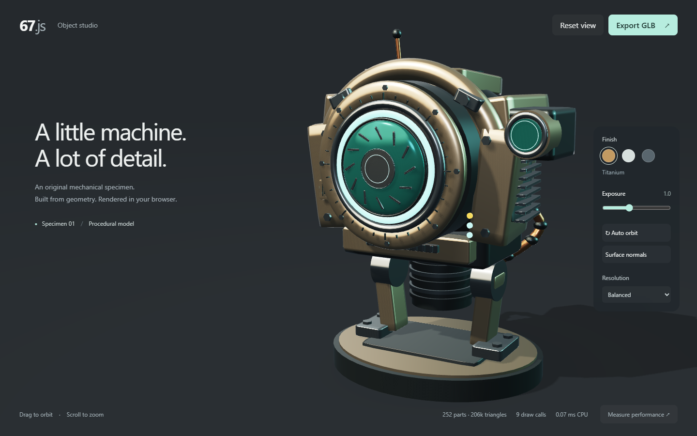

# 67.js

67.js is an experimental WebGL2 renderer with an original procedural 3D model and an interactive object studio.
The demo runs without Three.js. The performance comparison loads Three.js only when requested.



The specimen contains 252 parts and 206,432 triangles across eight shared geometries.
The renderer submits nine draw calls, including the studio floor.
Its materials use a GGX lighting model, analytical studio reflections, a static shadow map and ACES tone mapping.

The studio supports orbiting, zooming, three finishes, exposure adjustment, surface inspection and GLB export.
The exported model opens in glTF viewers. Blender supports importing this GLB format.

## Run

1. Install Node.js 22.12 or newer.
2. Run `npm ci`.
3. Run `npm run dev`.
4. Open the URL printed by Vite.

## Checks

1. Run `npm test` to check geometry and GLB export with an independent glTF loader.
2. Run `npm run build` to create the production site in `dist/`.
3. Run `npm run smoke` to exercise the studio in headless Chrome.

The smoke script uses installed Chrome on Windows, or Playwright Chromium on other platforms.
If Chromium is missing, run `npx playwright install chromium`.
The smoke saves screenshots, a GLB and benchmark results under the ignored `artifacts/` directory.

## Performance

The benchmark compares 67.js and Three.js with identical geometry, camera, resolution and flat shaders.
Each renderer runs with instancing and with individual meshes.
It measures CPU draw submission, with GPU synchronization outside the timed region.
The reported value is the median of 120 samples after 30 warmup samples.
Each sample averages eight submissions to reduce clock rounding.

The local Chrome run on an RTX 3060 measured these medians.

| Renderer | CPU milliseconds | Draw calls |
| --- | ---: | ---: |
| 67.js, instanced | 0.0056 | 9 |
| Three.js, instanced | 0.0169 | 9 |
| 67.js, individual | 0.0319 | 253 |
| Three.js, individual | 0.4238 | 253 |

These results apply to this static scene and CPU submission only.
The benchmark images agreed on more than 99.99% of color channels within one byte of tolerance.
They do not establish a general speed advantage, GPU performance or matching image quality against Three.js or Blender.
Vite serves isolation headers for finer browser timers. Other hosts need equivalent COOP and COEP headers for comparable measurements.

## Renderer shape

`createModel()` returns a flat array of parts.
Each part has a shared geometry, a column-major transform, a name and a metallic/roughness material.
`Renderer67` groups parts by geometry identity and uploads transforms, normal matrices and materials as instance attributes.
The studio renders on demand, with continuous rendering enabled only for auto orbit.
Hidden tabs stop rendering. Static shadows do not rerender during camera movement.

```js
import { Renderer67 } from './src/renderer.js';
import { createModel } from './src/model.js';

const renderer = new Renderer67(canvas, createModel());
renderer.render({ eye: [4, 3, 5], target: [0, 1.35, 0] });
// Call resize() after changing the canvas dimensions.
// Call dispose() when the viewer is removed.
```

This prototype focuses on static procedural objects.
It does not yet support animation, texture maps, asset loading, ray tracing or a general scene graph.
Blender-level realism remains a visual target, rather than a verified equivalence claim.

## References

- [Three.js](https://threejs.org/) and its [source repository](https://github.com/mrdoob/three.js/).
- [Blender source](https://projects.blender.org/blender/blender).
- [gl-matrix](https://github.com/toji/gl-matrix) supplies the matrix operations.

The geometry and model in this repository are original. No Blender source or external model assets are included.
